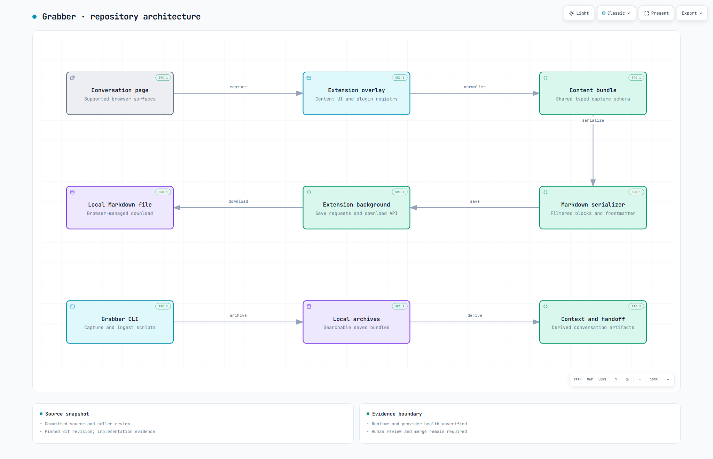

# Repository architecture map

Snapshot: [178135d0d89e](https://github.com/TheCrypDough/Grabber/commit/178135d0d89eaab4b3b711e309a8e0d29fbf05a0), inspected 2026-10-03.

[Interactive map](map.html) · [Source review](SOURCE_REVIEW.md) · [Tracked file inventory](tracked-files.txt) · [Visual review](REVIEW.md)

Download `map.html` and open it in a browser for searchable source-linked nodes, light/dark themes and export. GitHub shows HTML source; the image above is the rendered preview.

This is generated implementation evidence. Planned/document-only components are labeled where applicable. Runtime health, provider behavior and human acceptance are not established. Every repo keeps its own evidence; no customer records or credentials are included.

Archify delivery passed 9/9 showcase checks with zero errors and warnings. Browser containment was checked at four desktop sizes; an image-capable reviewer inspected four endpoint screenshots. See receipts and visual-review.json for separate artifact/browser/perceptual evidence. Published receipts normalize local paths; original HTML/specification/PNG hashes are unchanged.

Human review, repository checks and merge gates remain required. To refresh, inspect a new committed snapshot and callers before changing source pins, then use the pinned Archify renderer to deliver and collect new browser/visual evidence.
